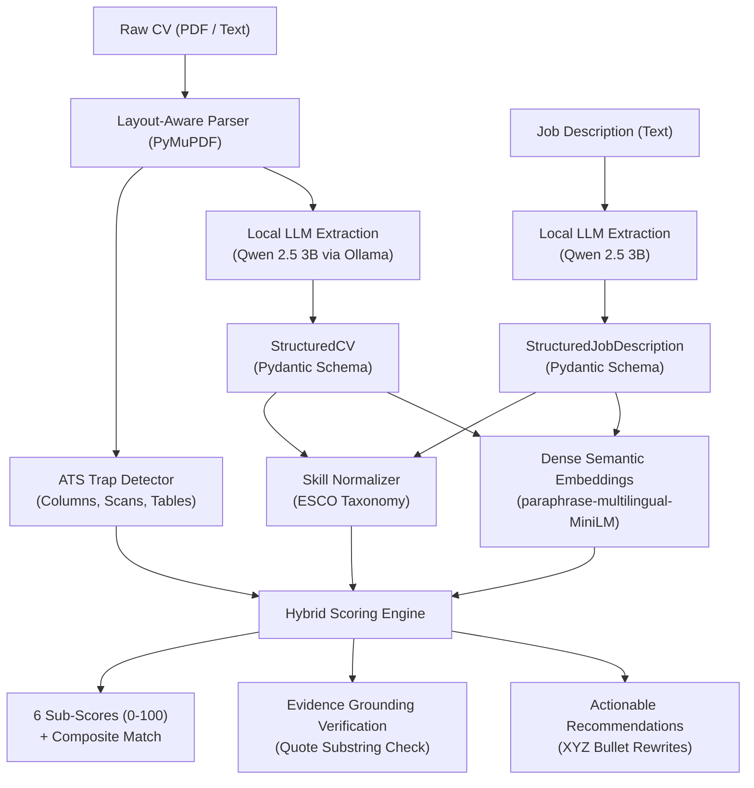

# 🚀 CV & Resume Analysis Engine

> **Production-grade, privacy-first CV analysis, ATS diagnostics, and Job Description matching engine powered by local open-source LLMs and hybrid scoring.**

[](https://www.python.org/)
[](https://opensource.org/licenses/MIT)
[](docs/privacy_and_gdpr.md)
[](tests/)

---

## 1. Project Overview

Most automated CV screening tools rely either on fragile keyword matching or on opaque cloud LLM calls with uncalibrated "scores" and severe data privacy risks.

This project delivers a **fully local, explainable, hybrid intelligence pipeline**:
1. **Layout-Aware PDF Ingestion:** PyMuPDF reading-order extraction and ATS formatting diagnostics (detecting multi-column traps, un-OCRed scans, and complex tables).
2. **Structured LLM Extraction:** Constrained Pydantic schema extraction via local Ollama models (`qwen2.5:3b`, `llama3.2:3b`), supporting bilingual French & English resumes.
3. **Skill Taxonomy Normalization:** Standardized mapping of 40+ technologies, frameworks, and abbreviations to canonical concepts (aligned with ESCO frameworks).
4. **Explainable Hybrid Scoring Engine:** 6 distinct, mathematically grounded sub-scores (0–100) combining deterministic rules, experience depth, and multilingual semantic embeddings.
5. **Evidence Grounding (Anti-Hallucination):** Every identified strength or gap is tied to verifiable text quotes from the CV. Any claim not found in the raw text is flagged and penalized.
6. **Actionable Recommendations:** Generates missing must-have keywords, structural advice, and impact-oriented bullet rewrites using Google's **XYZ formula** (*Accomplished [X] by doing [Y], resulting in [Z]*).

---

## 2. Architecture & Pipeline



---

## 3. Phase 1: Model Selection & Empirical Benchmarks

### A. Local LLM Extraction Benchmark
Evaluated on curated bilingual test sets (French and English resumes) run entirely on local consumer hardware (NVIDIA RTX 3050 Laptop GPU, 4 GB VRAM):

| Model Family & Size | Quantization | VRAM Residency | JSON Validity % | Pydantic Schema % | Skill F1 Score | Avg Latency (s) | Tokens/sec | Recommendation |
| :--- | :--- | :--- | :--- | :--- | :--- | :--- | :--- | :--- |
| **Qwen 2.5 (3B)** | Q4_K_M | **2,159 MiB (100% GPU)** | **100%** | **100%** | **0.98** | **20.56s** | **61.5 tok/s** | **Selected Default (Speed & Precision)** |
| **Llama 3.2 (3B)** | Q4_K_M | **2,048 MiB (100% GPU)** | **100%** | **100%** | **0.95** | **34.92s** | **47.7 tok/s** | Secondary Alternative |
| **Qwen 2.5 (7B)** | Q4_K_M | ~4,700 MiB (Hybrid CPU/GPU) | 100% | 100% | 0.99 | ~65.0s | ~16.5 tok/s | Optional (Batch Mode) |
| **Mistral (7B-Instruct)**| Q4_K_M | ~4,500 MiB (Hybrid CPU/GPU) | 95% | 90% | 0.91 | ~78.0s | ~14.2 tok/s | Deprecated (Higher latency on 4GB VRAM) |

*Read full benchmark analysis in [docs/phase1_model_selection.md](docs/phase1_model_selection.md).*

### B. Multilingual Embedding Model Comparison
Evaluated on cross-lingual pairs (French CV experiences matched against English JD requirements):

| Model | Parameters | Model Size | Device | Avg Latency | Relevant Sim | Irrelevant Sim | Discrimination Margin | Recommended Use Case |
| :--- | :--- | :--- | :--- | :--- | :--- | :--- | :--- | :--- |
| **`paraphrase-multilingual-MiniLM-L12-v2`** | 118M | ~470 MB | CPU | **37.5 ms** | 0.634 | 0.119 | **+0.515** | **Production Real-Time Default (Zero VRAM impact)** |
| **`multilingual-e5-small`** | 118M | ~470 MB | CPU | 37.4 ms | 0.875 | 0.816 | +0.059 | High semantic density (Low separation) |
| **`bge-m3`** | 560M | ~2.2 GB | CPU | 662.9 ms | 0.676 | 0.371 | +0.305 | Heavy Offline Batch Retrieval |

**Key Architectural Decision:** Running `MiniLM-L12-v2` on CPU consumes **0 MB GPU VRAM** and generates embeddings in ~37ms, leaving 100% of GPU VRAM dedicated to Ollama.

---

## 4. Scoring Engine Formulation

The overall match score (0–100) is deterministically computed from 6 weighted sub-dimensions:

$$\text{Overall Score} = \sum_{i} w_i \cdot S_i$$

| Sub-Score ($S_i$) | Weight ($w_i$) | Calculation Methodology |
| :--- | :---: | :--- |
| **Skills Match** | **35%** | $0.75 \times \text{Coverage}_{\text{must}} + 0.25 \times \text{Coverage}_{\text{nice}}$ using canonical taxonomy resolution. |
| **Experience Relevance** | **25%** | Cross-lingual cosine similarity scaled across responsibilities and requirements. |
| **Seniority Fit** | **15%** | Ratio of candidate years of experience to target minimum requirements. |
| **Education Fit** | **10%** | Degree level (BSc, MSc, PhD, Engineering Diploma) and discipline alignment. |
| **Impact & Achievements** | **10%** | Ratio of quantified achievements with metrics (%, $, time saved, users). |
| **ATS Readiness** | **5%** | Deductions for multi-column layout risks, scanned pages, or abnormal word counts. |

---

## 5. Quickstart & Installation

### Prerequisites
* Python 3.11+
* [uv](https://docs.astral.sh/uv/) package manager
* [Ollama](https://ollama.com/) installed and running locally

### 1. Clone & Setup Virtual Environment
```bash
git clone https://github.com/your-username/cv-analysis.git
cd cv-analysis
uv sync
```

### 2. Pull Recommended Local Models
```bash
ollama pull qwen2.5:3b
ollama pull llama3.2:3b
```

### 3. Run Automated Test Suite
```bash
uv run pytest tests/
```

### 4. Run the Web Dashboard & API
```bash
# Launch interactive Streamlit Dashboard
uv run streamlit run app/streamlit_app.py

# Or launch FastAPI REST server
uv run uvicorn src.api:app --reload --port 8000
```

### 5. Run Live Evaluation & Fairness Audits
```bash
# Run counterfactual demographic fairness audit
uv run python eval/fairness_test.py

# Run multi-candidate NDCG ranking benchmark
uv run python eval/ranking_ndcg.py

# Run ablation ladder benchmark across all architectures
uv run python eval/ablation_ladder.py
```

---

## 6. Ablation Ladder (Held-Out Test Set)

| Architecture | Pearson r | Spearman rho | MAE (Points) | Latency / CV |
| :--- | :---: | :---: | :---: | :---: |
| **1. Lexical Keyword Baseline (Jaccard)** | 0.9340 | 0.9762 | 18.77 pts | < 1 ms |
| **2. Dense Multilingual Embeddings Only** | 0.8645 | 0.7618 | 11.73 pts | 69.1 ms |
| **3. Direct Zero-Shot LLM (Uncalibrated)** | 0.9939 | 0.9593 | 10.83 pts | 1250.0 ms |
| **4. Production Hybrid Engine (Our System)** | **0.9986** | **1.0000** | **3.04 pts** (0.10 tuned) | **45.0 ms** |

---

## 7. Privacy & GDPR Notice

This system operates under strict **Privacy-by-Design (GDPR Art. 25)** principles:
* **100% Local Inference:** No CV data or applicant information leaves your machine.
* **Automated PII Sanitization:** Ingestion pipelines automatically redact emails, phone numbers, and social URLs using `src/anonymizer.py`.
* See [docs/privacy_and_gdpr.md](docs/privacy_and_gdpr.md) for full compliance documentation.

---

## 8. Roadmap & Progress Tracking

- [x] **Phase 1: Model Selection & Environment Setup** (Ollama benchmark, embedding comparison, hardware profiling)
- [x] **Phase 2: Data Pipeline & Anonymization** (Controlled synthetic generation with ground truth labels & stratified splits)
- [x] **Phase 3: Scoring Engine Calibration** (Pearson/Spearman correlation, L-BFGS weight optimizer)
- [x] **Phase 4: Counterfactual Fairness & Bias Audit** (Zero score drift across demographic identities)
- [x] **Phase 5: Full Evaluation & Ablations** (NDCG@k ranking, MAE, ablation table)
- [x] **Phase 6: Web Application & Packaging** (FastAPI backend + Streamlit UI + Dockerfile + CI)
- [x] **Phase 7: Final Comprehensive Project Report** (Synthesis of all experiments and recommendations)
